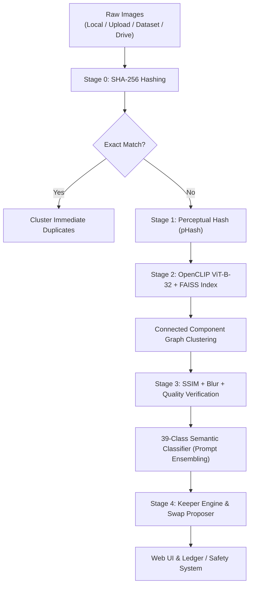

# ARGUS — Local-First Intelligent Image Deduplication

<p align="center">
  <strong>High-precision image deduplication, clustering, semantic categorization, and safe library cleanup.</strong>
</p>

<p align="center">
  <a href="#what-it-does">What It Does</a> •
  <a href="#architecture">Architecture & Visuals</a> •
  <a href="#installation">Installation</a> •
  <a href="#running-argus">Running Argus</a> •
  <a href="#docker-deployment">Docker</a> •
  <a href="#limits-and-quotas">Limits</a> •
  <a href="#privacy-note">Privacy Note</a>
</p>

---

## What It Does

Argus is an open-source, local-first image deduplication and library management platform. It identifies exact byte-for-byte duplicates as well as near-duplicate images resulting from crops, aspect ratio changes, color adjustments, watermark additions, and recompressions, without sending your pictures to any third-party cloud.

### Key Capabilities

- **Multi-Stage Detection Pipeline**:
  - **Stage 0 (Exact Match)**: Instant SHA-256 cryptographic hashing to find identical copies in `<0.01ms` per pair.
  - **Stage 1 (Perceptual Match)**: pHash perceptual hashing with adaptive Hamming distance thresholds for quick structural similarity filtering.
  - **Stage 2 (Semantic Embedding & ANN)**: OpenCLIP (`ViT-B-32`) vision transformer embeddings combined with FAISS cosine similarity index and connected-component graph clustering.
  - **Stage 3 (Multi-Metric Quality Verification)**: Structural Similarity Index (SSIM), Laplacian sharpness variance, pixel resolution, color fidelity, and JPEG quantization basis analysis.
  - **Stage 4 (Keeper Proposal & Safety)**: Automated keeper selection recommending which image to retain and which copies are safe to remove.
- **Three Deduplication Modes**:
  - **Conservative**: Flags only obvious byte-identical or near-identical duplicates; strictly prevents quality regression.
  - **Balanced** *(Default)*: Balances disk savings with image fidelity; flags resizing and recompression duplicates while preserving highest-quality references.
  - **Aggressive**: Maximizes storage savings; proposes swapping larger references with high-quality smaller recompressions when SSIM $\ge 92\%$ and sharpness is preserved.
- **39-Class Semantic Taxonomy**:
  - Automatic zero-shot image classification into 39 specific categories (*portrait/selfie, baby, pet dog, pet cat, food and drink, beach, mountains, sunset, city street, screenshot, document, car, meme*, etc.) powered by CLIP prompt ensembles (5 prompt templates averaged per label) achieving $>95\%$ Top-3 accuracy.
  - Top-2 semantic predictions and confidence scores are surfaced per cluster and per image card.
  - Users can manually override or edit category labels.
- **Dual-View Web Interface**:
  - **Duplicates View**: Side-by-side inspection of duplicate clusters, difference highlight overlays, candidate badges, keeper indicators, and one-click batch trash actions.
  - **All Photos View**: Complete photo library explorer supporting search by filename, category filter dropdown, thumbnail grids, file sizes, and jump-to-cluster shortcuts.
- **Bulk Streamed Downloads**:
  - Streamed ZIP downloads directly from the backend with strict user isolation:
    - Download all files in a specific cluster.
    - Download arbitrary user-selected images.
    - Download all recommended keepers across all clusters in a single archive.
- **Multi-Source Ingestion**:
  - Local directory scanning via CLI.
  - Multi-file drag-and-drop web uploads.
  - Hugging Face / HTTP dataset URL streaming with chunked processing (batches of 50).
  - Google Drive folder import with concurrent thread pools (8 workers), retry backoff, and modified-time caching.
- **Reversible Deletion & Ledger**:
  - All file moves route through an append-only SQLite action ledger (`actions` table).
  - Files are moved to OS Trash (macOS Trash or `.trash` directory), **never permanently deleted** with `rm`.
  - One-click **Undo** instantly restores moved files to their exact original disk locations.

---

## Architecture & Visuals

### Pipeline Architecture



### Web Interface Wireframes

#### Duplicates View
```
+---------------------------------------------------------------------------------------+
|  [ARGUS Logo] ARGUS          [All photos] [Duplicates]           user@example.com [v] |
+------------------------+--------------------------------------------------------------+
| MODES:                 | Cluster #4  •  Beach (94%)  •  Sunset (88%)                  |
| [Cons.] (Bal.) [Aggr.] | Potential savings: 14.8 MB (68%)                             |
+------------------------+--------------------------------------------------------------+
| Filter: [All Cats  v]  | [Keeper: DSC_0104.jpg]      [Copy: DSC_0104_compressed.jpg]  |
|                        | 6000 x 4000  •  18.2 MB     6000 x 4000  •  3.4 MB            |
| * Cluster #1 (3 files) | Sharpness: 142.6            Sharpness: 139.8 (SSIM: 98.2%)   |
| * Cluster #2 (2 files) | [Recommended Keeper]        [Safe to Trash]                  |
| * Cluster #3 (4 files) +--------------------------------------------------------------+
| * Cluster #4 (2 files) | [Select all safe copies]  [Move to trash]  [Download cluster]|
+------------------------+--------------------------------------------------------------+
```

#### All Photos (Library) View
```
+---------------------------------------------------------------------------------------+
|  [ARGUS Logo] ARGUS          (All photos) [Duplicates]           user@example.com [v] |
+---------------------------------------------------------------------------------------+
| Search: [Search photos...     ]  Category: [Food and drink (18) v]  [Download Keepers]|
+---------------------------------------------------------------------------------------+
|  +------------------+   +------------------+   +------------------+                   |
|  | [Thumbnail]      |   | [Thumbnail]      |   | [Thumbnail]      |                   |
|  | pasta_lunch.jpg  |   | puppy_walk.jpg   |   | golden_gate.jpg  |                   |
|  | 3.2 MB • 4K      |   | 1.8 MB • 1080p   |   | 4.6 MB • 4K      |                   |
|  | Food (92%)       |   | Pet dog (96%)    |   | Landmark (89%)   |                   |
|  | [Cluster #2]     |   | [Cluster #8]     |   | [Unique Photo]   |                   |
|  +------------------+   +------------------+   +------------------+                   |
|  Page 1 of 4  [< Prev] [1] [2] [3] [4] [Next >]                                       |
+---------------------------------------------------------------------------------------+
```

---

## Installation

### Prerequisites

- **Python 3.11** or later
- **macOS** (Apple Silicon M-series or Intel) or **Linux** (Ubuntu 22.04+)
- 4GB+ RAM (8GB+ recommended for large collections)

### 1. Clone & Set Up Virtual Environment

```bash
git clone https://github.com/manthanj/argus.git
cd argus

python3.11 -m venv .venv
source .venv/bin/activate
```

### 2. Install Dependencies

```bash
pip install --upgrade pip
pip install -r requirements.txt
pip install -e .
```

### 3. Cache OpenCLIP Weights (Fast Offline Startup)

Pre-download the `ViT-B-32` weights to eliminate runtime download delays:

```bash
python -c "import open_clip; open_clip.create_model_and_transforms('ViT-B-32', pretrained='laion2b_s34b_b79k')"
```

---

## Running Argus

### Launching the Web Server

Run the Argus API and Web UI server:

```bash
argus serve --host 127.0.0.1 --port 8000
```

Upon boot, Argus performs an automatic startup self-check:
```text
==================================================
  ARGUS Startup Self-Check
==================================================
  Data Directory : /Users/user/.argus
  DB Path        : /Users/user/.argus/argus.db
  Secret Key Set : yes
==================================================
```

Open `http://127.0.0.1:8000` in your web browser. First-time users can register an account and immediately start uploading and managing photo collections.

### CLI Usage

Argus provides CLI commands for headless terminal operations:

```bash
# 1. Scan a local folder into an Argus database
argus scan ~/Pictures/Vacation --db vacation.db

# 2. Cluster duplicates across conservative, balanced, or aggressive modes
argus cluster --db vacation.db --mode balanced

# 3. Review duplicate clusters in terminal
argus review --db vacation.db

# 4. Preview safe deletions without touching files
argus apply --db vacation.db --dry-run

# 5. Move safe copies to trash
argus apply --db vacation.db

# 6. Undo the last deletion batch
argus undo --db vacation.db
```

### Google Drive Authentication

To enable Google Drive folder ingestion:

```bash
argus drive-auth --client-secret /path/to/client_secret.json
```

Follow the terminal instructions to authorize read access. Tokens are cached locally in your persistent data root.

---

## Docker Deployment

Argus includes a multi-stage `Dockerfile` and `docker-compose.yml` for containerized deployments:

```bash
# Build and run in detached mode
docker compose up --build -d

# Check health and self-check state
curl http://localhost:8000/healthz

# Stop the container
docker compose down
```

> [!CAUTION]
> **Never run `docker compose down -v`**.
> The `-v` flag destroys Docker named volumes, which will permanently delete your `argus_data` volume containing your user database, uploaded libraries, and ledger journals.

See [DEPLOY.md](DEPLOY.md) for full deployment instructions covering Docker, Cloudflare Tunnels, and Hugging Face Spaces.

---

## Limits and Quotas

| Parameter | Default Value | Description |
|-----------|---------------|-------------|
| **Supported File Formats** | JPEG, PNG, WebP, HEIC/HEIF, TIFF, BMP | Validated via magic bytes and Pillow decoder. |
| **Per-File Size Limit** | 50 MB | Files exceeding this limit are safely rejected with clear UI feedback. |
| **Max Concurrent Jobs** | 1 active job per user | Jobs queue per user to prevent CPU/memory exhaustion. |
| **Login Rate Limiting** | 5 attempts / min | Protects accounts against brute-force password guessing. |
| **Session Lifetime** | 24 hours | Secure HTTP-only cookies with CSRF token verification on state-changing requests. |
| **Host Directory Confinement** | Strict sandboxing | Prevents path traversal and symlink escapes outside the user library root. |

---

## Privacy Note

- **100% Local-First**: All vision transformers, perceptual hash algorithms, SIFT/SSIM calculations, and database operations execute locally on your hardware.
- **Zero Telemetry**: Argus contains no tracking pixels, telemetry probes, third-party analytics, or remote cloud pings.
- **Air-Gapped & Offline Capable**: Once model weights are cached, Argus can run completely severed from the internet.
- **Reversible Safety**: Deletions move files to system trash and log cryptographic records to the SQLite ledger, enabling instant undo at any time.

---

## License

MIT License. See [LICENSE](LICENSE) for details.
